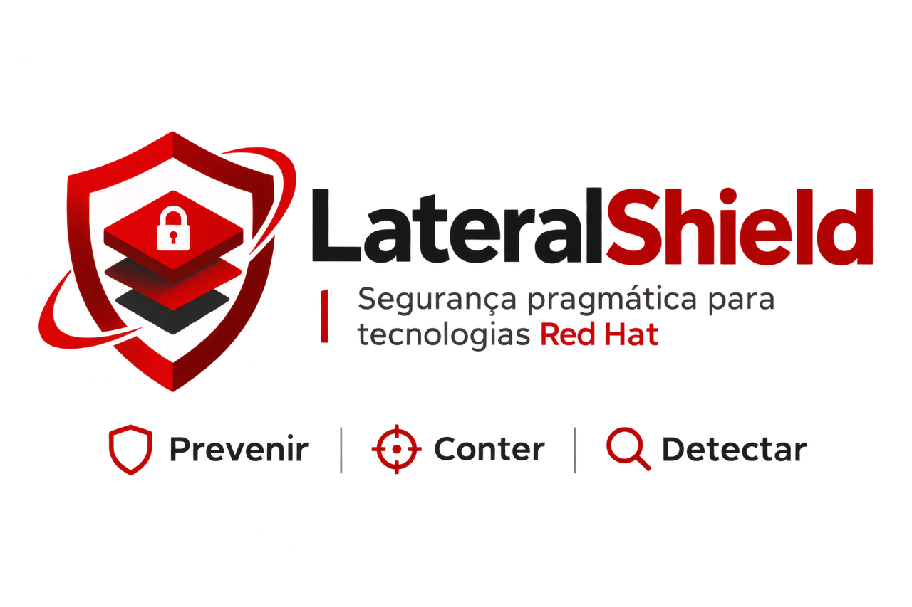
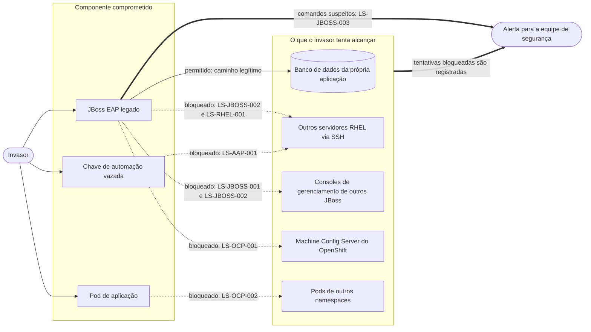

  

# LateralShield

**Segurança pragmática para tecnologias Red Hat.**

**Prevenir. Conter. Detectar.**

*Assuma o comprometimento. Contenha o impacto.*

O LateralShield é um projeto open source que reúne tecnologias, métodos, processos, recomendações e automações simples de implementar para prevenir ataques, conter movimentações laterais e detectar atividades suspeitas em ambientes baseados em soluções Red Hat.

Inspirado no princípio 80/20, busca identificar medidas de alto impacto e baixa complexidade, capazes de melhorar significativamente a postura de segurança sem exigir grandes projetos ou investimentos.

> O LateralShield é uma iniciativa comunitária independente. **Não é um produto oficial nem suportado pela Red Hat.** Red Hat, OpenShift, RHEL, JBoss e Ansible são marcas da Red Hat, Inc., citadas aqui apenas para identificar as tecnologias protegidas.

## O problema

A maioria dos incidentes graves não termina no primeiro servidor invadido. O atacante entra por um ponto fraco — um JBoss EAP legado que não pode ser atualizado, uma credencial vazada, um pod vulnerável — e a partir dali se move para dentro: banco de dados, outros servidores, o plano de controle do cluster.

Dois exemplos que motivaram o projeto:

- **JBoss EAP legado.** Há servidores que não podem ser atualizados no curto prazo. Se não é possível impedir toda invasão, é possível impedir que o processo do JBoss abra conexões para qualquer destino além do banco de dados que ele realmente usa. Ver [LS-JBOSS-002](catalogo/jboss-eap/LS-JBOSS-002-egress-por-usuario.md).
- **OpenShift.** O Machine Config Server (portas 22623/22624) entrega a configuração Ignition dos nós sem autenticação para quem alcançar a porta na rede local. Ver [LS-OCP-001](catalogo/openshift/LS-OCP-001-machine-config-server.md).

## O propósito das proteções

O diagrama mostra a ideia central: um componente foi invadido, e as proteções decidem o que ele consegue alcançar a partir dali. O caminho de que a aplicação precisa continua aberto; os demais são bloqueados, e cada tentativa bloqueada vira um alerta.

Linhas contínuas são tráfego permitido, linhas tracejadas são tentativas de movimentação lateral bloqueadas e linhas grossas são sinais de detecção.

| Pilar | Papel no diagrama | Controles |
|---|---|---|
| **Prevenir** | Dificulta a invasão inicial e fecha o que não deveria estar exposto | [LS-JBOSS-001](catalogo/jboss-eap/LS-JBOSS-001-interfaces-de-gerenciamento.md) |
| **Conter** | Bloqueia os caminhos tracejados: o componente invadido só alcança o que realmente usa | [LS-JBOSS-002](catalogo/jboss-eap/LS-JBOSS-002-egress-por-usuario.md), [LS-RHEL-001](catalogo/rhel/LS-RHEL-001-ssh-somente-de-origens-administrativas.md), [LS-OCP-001](catalogo/openshift/LS-OCP-001-machine-config-server.md), [LS-OCP-002](catalogo/openshift/LS-OCP-002-networkpolicy-negacao-padrao.md), [LS-AAP-001](catalogo/aap/LS-AAP-001-chave-de-automacao-restrita.md) |
| **Detectar** | Transforma cada tentativa bloqueada e cada comando anômalo em alerta | [LS-RHEL-002](catalogo/rhel/LS-RHEL-002-syslog-central.md), [LS-OCP-003](catalogo/openshift/LS-OCP-003-log-de-acesso-do-ingress-em-syslog.md), [LS-JBOSS-003](catalogo/jboss-eap/LS-JBOSS-003-auditoria-de-processos.md), [LS-JBOSS-004](catalogo/jboss-eap/LS-JBOSS-004-logs-do-jboss-em-syslog.md) e os registros de bloqueio dos controles de contenção |

## Escopo tecnológico

| Tecnologia | Foco |
|---|---|
| **Red Hat OpenShift** | Infraestrutura do cluster, serviços internos, workloads, redes, identidades e interfaces administrativas |
| **Red Hat Enterprise Linux (RHEL)** | Hardening do sistema operacional, segmentação, controle de acesso, serviços e monitoramento |
| **Red Hat JBoss EAP** | Proteção de middleware, especialmente versões legadas que não podem ser atualizadas imediatamente |
| **Red Hat Ansible Automation Platform** | Automação de assessments, aplicação de controles e verificação de conformidade |

Outras tecnologias Red Hat podem entrar no escopo conforme a relevância dos riscos e a disponibilidade de contribuições. Ferramentas de terceiros são aceitas quando necessárias para proteger ambientes Red Hat, sem desviar o foco do projeto.

## Princípios

1. **Foco Red Hat** — problemas reais de segurança em ambientes que utilizam tecnologias Red Hat.
2. **Segurança 80/20** — o maior benefício de segurança com o menor esforço e complexidade possíveis.
3. **Prevenir, Conter e Detectar** — todo controle pertence a um desses três pilares.
4. **Simplicidade operacional** — funcionalidades nativas, configurações existentes e procedimentos reproduzíveis.
5. **Segurança na implementação** — todo controle documenta pré-requisitos, impactos, validação e reversão.
6. **Independência comercial** — sem conteúdo de vendas, posicionamento comercial ou geração de oportunidades.
7. **Colaboração aberta** — contribuições de qualquer profissional interessado.
8. **Português brasileiro** — toda a documentação pública em pt-BR.

## Como usar

1. Leia a [metodologia](docs/metodologia.md) e o [modelo de ameaça](docs/modelo-de-ameaca.md).
2. **Verifique primeiro se os logs saem dos servidores** para um syslog central ([LS-RHEL-002](catalogo/rhel/LS-RHEL-002-syslog-central.md), [LS-OCP-003](catalogo/openshift/LS-OCP-003-log-de-acesso-do-ingress-em-syslog.md), [LS-JBOSS-004](catalogo/jboss-eap/LS-JBOSS-004-logs-do-jboss-em-syslog.md)). Sem isso, os alertas dos demais controles não chegam a ninguém.
3. Escolha controles no [catálogo](catalogo/INDICE.md), começando pelos de impacto alto e esforço baixo.
4. Rode a etapa de **avaliação** de cada controle antes de mudar qualquer coisa.
5. Aplique em laboratório ou homologação, valide e só então leve para produção. Todo controle traz a reversão.
6. Use a [automação Ansible](automacao/README.md) para repetir avaliação e aplicação em escala.

Está com um incidente em andamento? As [recomendações gerais para incidentes](docs/recomendacoes-para-incidentes.md) reúnem medidas de emergência, como restringir a entrada no perímetro a endereços do Brasil, com os cuidados e a forma de desfazer cada uma.

## Estrutura do repositório

| Caminho | Conteúdo |
|---|---|
| [docs/](docs/) | Metodologia, modelo de ameaça, roadmap e recomendações gerais para incidentes |
| [catalogo/](catalogo/) | Controles, um arquivo por controle, organizados por tecnologia |
| [automacao/](automacao/) | Playbooks e roles Ansible de avaliação e aplicação |
| [scripts/](scripts/) | Validação do catálogo e geração do índice |
| [apresentacao/](apresentacao/) | Deck de apresentação do projeto |

## Estado atual

Projeto em fase inicial. Os controles publicados estão com status `rascunho`: foram escritos a partir de documentação e experiência de campo, mas **ainda não passaram pela validação em laboratório** exigida pela metodologia. Teste antes de aplicar em produção. O [roadmap](docs/roadmap.md) lista o que vem a seguir.

## Contribuindo

Veja [CONTRIBUTING.md](CONTRIBUTING.md). Relatos de campo, correções e novos controles são bem-vindos.

## Licença

[Apache License 2.0](LICENSE).
