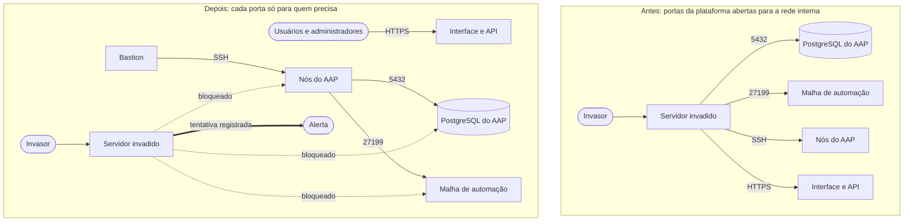

# LS-AAP-010 — Segmentar a rede dos nós do AAP

## Problema

Os nós do AAP expõem serviços que só interessam à própria plataforma: o PostgreSQL com as credenciais cifradas, a malha de automação (receptor) que distribui jobs e, no AAP 2.5 ou superior, o Redis. Quando esses servidores ficam em uma rede comum, qualquer host invadido da mesma rede pode tentar o banco de dados, a malha e o SSH dos nós.

O AAP é o destino mais valioso de uma movimentação lateral: quem o controla, controla os servidores que ele gerencia. Deixar suas portas internas ao alcance de servidores de aplicação é oferecer ao invasor um caminho que não precisava existir.

## Benefício

Um servidor invadido em outra parte do ambiente deixa de alcançar o banco de dados, a malha e o SSH da plataforma. O único serviço do AAP visível fora dos seus nós passa a ser a interface HTTPS, e apenas para as redes de onde os usuários realmente acessam.

Como nenhum outro servidor tem motivo para falar com essas portas, cada tentativa bloqueada é um sinal de reconhecimento interno.



## Pré-requisitos

- Lista dos nós da plataforma e do papel de cada um: gateway, controller, hub, Event-Driven Ansible, banco de dados, nós de execução e de salto.
- A tabela de portas do guia de planejamento da versão e da topologia em uso. As portas internas variam entre a 2.4 e a 2.5 ou superior, e entre instalação RPM e em contêiner.
- Redes de origem dos usuários, do bastion e do servidor de instalação.
- Acesso de console fora de banda aos nós.

## Avaliação

Em cada nó:

```bash
ss -tlnp
firewall-cmd --get-active-zones
firewall-cmd --list-all-zones | grep -E '^\S|sources:|services:|ports:|rich rules:'
```

De um servidor que **não** faz parte da plataforma, verifique o que responde:

```bash
for porta in 22 443 5432 6379 27199; do
  timeout 3 bash -c "</dev/tcp/192.0.2.30/$porta" 2>/dev/null && echo "$porta aberta"
done
```

Interpretação: de um servidor comum, o esperado é que nenhuma dessas portas responda. De uma estação de usuário, apenas a 443. Qualquer resposta em 5432, 6379 ou 27199 fora dos nós da plataforma é **exposição**.

## Implementação

Aplique com o firewalld de cada nó ([LS-RHEL-008](../rhel/LS-RHEL-008-firewalld-somente-o-necessario.md)) e, quando houver, também no firewall entre redes. As portas a tratar:

| Porta | Serviço | Quem precisa alcançar |
|---|---|---|
| 443/tcp | Interface e API (gateway na 2.5 ou superior; controller e hub na 2.4) | Redes de usuários e de administração; demais nós da plataforma |
| 5432/tcp | PostgreSQL | Somente os nós dos componentes que usam o banco |
| 27199/tcp | Malha de automação (receptor) | Somente controllers, nós de salto e nós de execução |
| 6379/tcp | Redis (2.5 ou superior) | Somente os nós dos componentes que o usam |
| 22/tcp | SSH | Bastion e servidor de instalação |

A 27199 é o padrão e pode ter sido alterada na instalação. A topologia em uso pode ter outras portas internas; confira a tabela do guia antes de fechar.

**1. Criar uma zona para os nós da plataforma.** Exemplo no nó do banco de dados. Aplique primeiro só em tempo de execução, sem `--permanent`:

```bash
firewall-cmd --permanent --new-zone=ls-aap && firewall-cmd --reload   # criar zona exige --permanent

firewall-cmd --zone=ls-aap --add-source=192.0.2.21/32     # controller
firewall-cmd --zone=ls-aap --add-source=192.0.2.22/32     # gateway ou hub
firewall-cmd --zone=ls-aap --add-port=5432/tcp
firewall-cmd --zone=public --remove-port=5432/tcp         # ajuste para a zona e a forma como a porta está liberada
```

Nos controllers e nós de execução, faça o mesmo com a 27199, tendo como origem os nós da malha.

**2. Restringir o SSH** às origens administrativas, como em [LS-RHEL-001](../rhel/LS-RHEL-001-ssh-somente-de-origens-administrativas.md). Inclua o servidor de instalação.

**3. Restringir o HTTPS** às redes de onde usuários, administradores e integrações acessam. Se o AAP fica atrás de um balanceador, a origem vista pelos nós é o balanceador, e a restrição por rede de usuário é feita nele.

**4. Testar e tornar permanente.** Rode um job que use nós de execução, acesse a interface e, com tudo funcionando:

```bash
firewall-cmd --runtime-to-permanent
```

No AAP instalado por operador no OpenShift, a segmentação equivalente é feita com NetworkPolicy no namespace da plataforma ([LS-OCP-002](../openshift/LS-OCP-002-networkpolicy-negacao-padrao.md)).

## Validação

- O teste de portas da avaliação, de um servidor comum, não mostra nenhuma porta aberta.
- A interface abre a partir das redes de usuários.
- Um job em cada grupo de instâncias executa, e os nós da malha aparecem saudáveis (`awx-manage list_instances` no controller).
- O instalador alcança todos os nós a partir do servidor de instalação.

## Reversão

Antes de tornar permanente, `firewall-cmd --reload` desfaz. Depois:

```bash
firewall-cmd --permanent --zone=public --add-port=5432/tcp
firewall-cmd --permanent --delete-zone=ls-aap
firewall-cmd --reload
```

## Impacto operacional

- Ao acrescentar um nó (controller, execução, salto), inclua-o nas origens **antes** de usá-lo; caso contrário, ele não entra na malha ou não alcança o banco.
- A direção das conexões da malha depende do inventário de instalação: controllers podem conectar aos nós de execução ou o contrário. Confira antes de definir as origens.
- Os nós de execução precisam continuar alcançando o hub (443) para baixar execution environments, e os hosts gerenciados nas portas de gerência.
- Uma nova execução do instalador pode reaplicar regras de firewall. Repita a avaliação depois de cada upgrade.
- Integrações que consultavam o banco do AAP diretamente param. Devem usar a API.

## Detecção

Registre as tentativas vindas de fora da plataforma nas portas internas que cada nó escuta:

```bash
firewall-cmd --permanent --zone=public \
  --add-rich-rule='rule port port="5432" protocol="tcp" log prefix="LS-AAP-REDE: " level="warning" limit value="10/m" drop'
firewall-cmd --permanent --zone=public \
  --add-rich-rule='rule port port="27199" protocol="tcp" log prefix="LS-AAP-REDE: " level="warning" limit value="10/m" drop'
firewall-cmd --reload
```

Um servidor de aplicação tentando o banco ou a malha do AAP não tem explicação legítima. Encaminhe as mensagens `LS-AAP-REDE` ao destino central ([LS-RHEL-002](../rhel/LS-RHEL-002-syslog-central.md)) e alerte.

## Referências

- Documentação do Ansible Automation Platform 2.5: *Planning your installation* (Network ports and protocols) e *Tested deployment models*.
- Documentação do Ansible Automation Platform 2.4: *Red Hat Ansible Automation Platform planning guide* (Network ports and protocols).
- Documentação do Ansible Automation Platform: *Hardening and compliance*, recomendações de restringir a porta do PostgreSQL aos componentes da plataforma e o SSH a hosts de manutenção.
- Documentação do RHEL: *Configuring firewalls and packet filters* (Working with firewalld zones).
