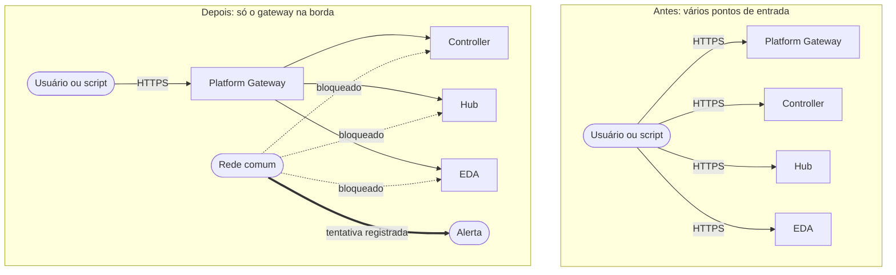

# LS-AAP-012 — Publicar apenas o Platform Gateway como entrada

## Problema

No AAP 2.5 ou superior, o Platform Gateway é o serviço que autentica, autoriza e serve a interface unificada. Controllers, private automation hub e Event-Driven Ansible continuam escutando HTTPS, mas esse acesso direto existe sobretudo para compatibilidade com instalações migradas da 2.4.

Quando DNS, balanceador ou firewall ainda publicam FQDNs ou IPs desses componentes para a rede de usuários e integrações, o invasor escolhe o caminho mais fraco: uma conta local legada no controller, um token antigo de componente ou uma API que ainda não passou pelo mapeamento do gateway. A autenticação centralizada ([LS-AAP-008](LS-AAP-008-idp-corporativo-sem-contas-compartilhadas.md), [LS-AAP-002](LS-AAP-002-mfa-no-provedor-de-identidade.md)) deixa de valer para quem entra pela porta de trás.

## Benefício

Todo acesso humano e de integração à plataforma passa por um único ponto: o Platform Gateway. Contas locais órfãs, tokens de componente e papéis que só existem atrás do gateway deixam de ser alcançáveis a partir da rede externa à plataforma.

A operação passa a ter um FQDN e um certificado para cuidar, e cada tentativa de falar direto com controller, hub ou EDA vira sinal de bypass ou de configuração esquecida.



## Pré-requisitos

- AAP 2.5 ou superior, com Platform Gateway instalado e saudável.
- Lista dos FQDNs e IPs publicados hoje para gateway, controller, hub e Event-Driven Ansible, inclusive no balanceador.
- Acesso para alterar DNS, regras do balanceador e firewall entre a rede de usuários e os nós da plataforma.
- Confirmar quais integrações ainda apontam para URLs de componente (API do controller `/api/v2/`, hub, EDA).

## Avaliação

**1. Inventariar o que responde na 443** a partir de uma estação da rede de usuários (não de um nó da plataforma):

```bash
for alvo in aap.exemplo.com.br controller.exemplo.com.br \
            hub.exemplo.com.br eda.exemplo.com.br; do
  codigo=$(curl -sk -o /dev/null -w '%{http_code}' --connect-timeout 5 "https://$alvo/" || echo falha)
  echo "$alvo $codigo"
done
```

**2. Conferir o balanceador e o DNS.** Liste os backends HTTPS e os registros que apontam para IPs de controller, hub ou EDA. Qualquer nome ainda usado por pessoas ou scripts, fora do FQDN do gateway, é entrada paralela.

**3. Procurar URLs legadas em scripts e job templates** (variáveis de ambiente, cofres, inventários de automação) com caminhos como `/api/v2/` apontando para o host do controller, e não para o gateway.

Interpretação: de fora da plataforma, só o FQDN do gateway (e, se houver, o balanceador à frente dele) deve responder. Resposta HTTPS de controller, hub ou EDA a partir da rede de usuários é **exposição**. Comunicação interna entre os próprios nós da plataforma na 443 é esperada e não conta como entrada externa.

## Implementação

**1. Migrar clientes para o gateway.** Atualize bookmarks, pipelines e ferramentas para o FQDN do Platform Gateway. Tokens e aplicações OAuth devem ser criados no gateway ([LS-AAP-013](LS-AAP-013-tokens-e-oauth-no-gateway.md)); tokens só do controller da 2.4 não bastam depois do corte.

**2. Remover backends e registros DNS** de controller, hub e EDA no balanceador e na zona DNS usada pelos usuários. Mantenha os nomes internos, se a plataforma os usar entre nós.

**3. Restringir a 443 dos componentes** às origens dos nós da plataforma (em especial o gateway) e, se necessário, ao servidor de instalação — no mesmo espírito de [LS-AAP-010](LS-AAP-010-segmentacao-de-rede-dos-nos.md). Aplique primeiro em modo de observação (log sem drop) se o firewall permitir, para achar clientes esquecidos.

**4. Validar após upgrades e inclusão de nós.** Upgrades a partir da 2.4 e novos nós costumam reabrir rotas “por compatibilidade”. Inclua esta verificação no checklist pós-upgrade.

## Validação

- A partir da rede de usuários, apenas o FQDN do gateway responde na 443.
- Login na interface unificada, listagem de job templates e um job de teste funcionam pelo gateway.
- `curl` para os FQDNs antigos de componente falha por timeout ou recusa de conexão.
- Integrações críticas autenticam no gateway e executam as operações que precisam.

## Reversão

Recrie o registro DNS ou o backend do balanceador para o componente afetado e reabra a 443 na origem necessária. A reversão é por componente; não é preciso republicar todos de uma vez.

## Impacto operacional

- Scripts que ainda usam a API legada do controller param até apontarem para o gateway. Mudanças feitas só pela API legada podem levar cerca de 15 minutos para propagar e gerar erros transitórios — prefira a API e a Unified UI do gateway.
- Ferramentas de monitoramento que batiam em `/api/v2/ping/` no controller precisam do caminho equivalente via gateway ou de checagem interna à rede da plataforma.
- Nós de execução e o próprio controller continuam precisando alcançar o hub na 443; essa comunicação é interna e não deve ser cortada.

## Detecção

- Tentativa de HTTPS aos IPs ou FQDNs de controller, hub ou EDA vinda de fora da rede da plataforma. No firewalld, use rich rules com prefixo `LS-AAP-GW:` e encaminhe ao destino central ([LS-RHEL-002](../rhel/LS-RHEL-002-syslog-central.md)).
- Após upgrade, reaparecimento de backends ou registros DNS para componentes.
- Autenticação com sucesso em componente sem passar pelo gateway (se ainda houver log local de acesso nesses serviços).

## Referências

- Documentação do Ansible Automation Platform 2.5: *Planning your installation* (Network ports and protocols), nota de que conexões diretas do cliente a hub, EDA e controller na 2.5 existem para compatibilidade com upgrades a partir da 2.4.
- Documentação do Ansible Automation Platform 2.5: *Tested deployment models* (tráfego externo via load balancer para o Platform Gateway; gateway fala com controller, hub e EDA).
- Documentação do Ansible Automation Platform 2.5: *Hardening and compliance* e *Access management and authentication* (gateway como ingresso único da plataforma e da interface).
