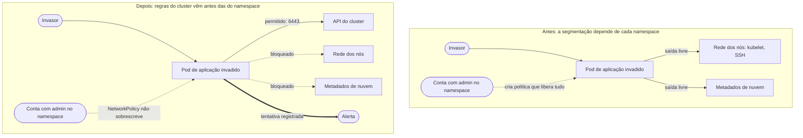

# LS-OCP-012 — Aplicar AdminNetworkPolicy para regras que o tenant não sobrescreve

## Problema

A NetworkPolicy ([LS-OCP-002](LS-OCP-002-networkpolicy-negacao-padrao.md)) pertence ao namespace. Quem administra o namespace pode criar uma política que libera tudo, ou apagar a de negação padrão — e um invasor com o token de uma conta com papel `admin` ou `edit` no namespace pode fazer o mesmo. A segmentação do cluster fica dependendo de cada time manter as próprias regras.

Além disso, a NetworkPolicy do conjunto base trata a entrada nos pods. A saída continua livre: um pod invadido alcança a rede dos nós — onde escutam o kubelet, o SSH e outros serviços de infraestrutura — e, em nuvem, o serviço de metadados da instância. O plugin de rede já bloqueia o acesso dos pods ao Machine Config Server ([LS-OCP-001](LS-OCP-001-machine-config-server.md)), mas não às demais portas dos nós.

## Benefício

As regras que protegem a infraestrutura passam a ser do cluster, e não do tenant. Um pod de aplicação invadido deixa de alcançar a rede dos nós e os metadados de nuvem, e nenhuma NetworkPolicy criada no namespace — por engano ou por um invasor — consegue reabrir esse caminho.

A operação ganha um ponto único para as poucas regras que valem para todos, definidas uma vez e aplicadas também aos namespaces que ainda vão ser criados.



## Pré-requisitos

- Cluster com o plugin de rede OVN-Kubernetes. A AdminNetworkPolicy tornou-se de disponibilidade geral no OpenShift 4.16; nas versões 4.14 e 4.15 era prévia de tecnologia, com diferenças de sintaxe.
- Permissão de administração do cluster.
- Um rótulo que identifique os namespaces de aplicação. Os exemplos usam `lateralshield.exemplo.com.br/tenant: "true"`.
- Saber quais aplicações falam com a API do cluster, com serviços nos nós ou com rotas do próprio cluster.

## Avaliação

```bash
oc get network.config cluster -o jsonpath='{.status.networkType}{"\n"}'
oc get adminnetworkpolicy
oc get baselineadminnetworkpolicy
```

- Tipo de rede diferente de `OVNKubernetes`: o recurso não está disponível.
- Nenhuma AdminNetworkPolicy: toda a segmentação do cluster pode ser desfeita por quem administra um namespace, e a saída dos pods para a rede dos nós não tem restrição de cluster. **Exposto.**

Para confirmar a exposição a partir de um pod de aplicação já existente, sem alterar nada, teste a porta do kubelet em um nó:

```bash
oc exec -n <namespace> <pod> -- curl -sk -o /dev/null -w '%{http_code}\n' --max-time 5 \
  https://<ip-de-um-no>:10250/healthz
```

Qualquer código HTTP (o esperado é `401`, porque o kubelet exige autenticação), em vez de `000` por tempo esgotado, mostra que o pod alcança a rede dos nós.

## Implementação

**1. Rotular os namespaces de aplicação.**

```bash
oc label namespace <namespace> lateralshield.exemplo.com.br/tenant=true
```

**2. Observar.** Crie a política com as regras de bloqueio em `Pass` e o registro ligado. `Pass` não bloqueia: entrega a decisão às NetworkPolicies do namespace, mas cada conexão que casar com a regra fica registrada.

```yaml
apiVersion: policy.networking.k8s.io/v1alpha1
kind: AdminNetworkPolicy
metadata:
  name: ls-conter-saida-dos-tenants
  annotations:
    k8s.ovn.org/acl-logging: '{"deny": "alert", "allow": "info", "pass": "warning"}'
spec:
  priority: 10
  subject:
    namespaces:
      matchLabels:
        lateralshield.exemplo.com.br/tenant: "true"
  egress:
    - name: permitir-api-do-cluster
      action: Allow
      to:
        - nodes:
            matchExpressions:
              - key: node-role.kubernetes.io/control-plane
                operator: Exists
      ports:
        - portNumber:
            protocol: TCP
            port: 6443
    - name: negar-rede-dos-nos
      action: Pass          # troque por Deny depois da observação
      to:
        - nodes:
            matchExpressions:
              - key: kubernetes.io/hostname
                operator: Exists
    - name: negar-metadados-de-nuvem
      action: Pass          # troque por Deny depois da observação
      to:
        - networks:
            - 169.254.169.254/32
```

As regras são avaliadas na ordem em que aparecem; a de permissão da API precisa vir antes da negação dos nós. Em uma lista de `networks`, um intervalo amplo como `0.0.0.0/0` também casa com o tráfego entre pods — use apenas os destinos que quer tratar.

**3. Bloquear.** Depois de alguns dias sem conexões legítimas nos registros (ver *Detecção*), troque `Pass` por `Deny` nas duas regras e reaplique.

**4. Opcional: negação padrão para o cluster.** A `BaselineAdminNetworkPolicy` (uma única, de nome `default`) define o comportamento dos namespaces que não têm NetworkPolicy própria. Serve para que namespaces novos nasçam fechados, mas pode ser sobrescrita pelo tenant; não substitui a AdminNetworkPolicy para o que não pode ser reaberto.

## Validação

Repita o teste da avaliação a partir de um pod em um namespace rotulado: a conexão à porta 10250 de um nó deve esgotar o tempo (código `000`). Em seguida confirme que:

- o pod continua resolvendo nomes e falando com os demais pods de que depende;
- uma aplicação que usa a API do cluster continua funcionando;
- uma NetworkPolicy de permissão total criada no namespace de teste **não** reabre o acesso aos nós.

## Reversão

```bash
oc delete adminnetworkpolicy ls-conter-saida-dos-tenants
```

Para desfazer apenas o bloqueio e manter a observação, volte as regras para `Pass`.

## Impacto operacional

- Pods que falam com serviços em rede do host param: agentes que consultam o kubelet, exportadores de métricas de nó, aplicações que acessam portas de nó (`NodePort`) pelo IP do nó. Mapeie-os na fase de observação e crie regras `Allow` específicas, com prioridade mais alta ou posicionadas antes da negação.
- Em plataformas onde o roteador de ingress usa a rede do host, pods que chamam rotas do próprio cluster podem ser afetados. Não foi possível confirmar esse comportamento em todas as plataformas: verifique na fase de observação antes de bloquear.
- Os pares `nodes` e `networks` em regras de saída aparecem na documentação a partir do OpenShift 4.16, e a referência da API ainda os marcava como experimentais em versões posteriores. Confira o suporte na versão em uso.
- A prioridade define a ordem entre AdminNetworkPolicies: número menor vence. Mantenha poucas políticas e registre o intervalo de prioridades reservado a cada finalidade.
- O rótulo do namespace passa a ser parte do controle: namespace de aplicação sem o rótulo fica de fora. Inclua o rótulo no modelo de projeto do cluster.

## Detecção

Com a anotação `k8s.ovn.org/acl-logging` na própria política, o OVN-Kubernetes registra cada conexão que casa com uma regra, com a ação (`allow`, `drop` ou `pass`), a origem e o destino. Os registros ficam no arquivo `/var/log/ovn/acl-audit-log.log` dos pods do OVN-Kubernetes em cada nó e fazem parte da entrada `audit` do encaminhamento de logs ([LS-OCP-006](LS-OCP-006-auditoria-da-api-fora-do-cluster.md)), que os leva ao destino central.

Depois do bloqueio, um pod de aplicação tentando alcançar a rede dos nós ou os metadados de nuvem é um sinal direto de reconhecimento ou de tentativa de obter credenciais. Alerte também para alteração ou remoção de `adminnetworkpolicies` e para a retirada do rótulo de tenant de um namespace ([LS-OCP-007](LS-OCP-007-alertas-de-rbac-scc-e-secrets.md)).

## Referências

- Documentação do OpenShift Container Platform: *Network security* (Admin network policy; Egress nodes and networks peer for AdminNetworkPolicy; BaselineAdminNetworkPolicy).
- Documentação do OpenShift Container Platform: *Network security* (Audit logging for network security — AdminNetworkPolicy audit logging).
- Documentação do OpenShift Container Platform: *Network APIs* (AdminNetworkPolicy e BaselineAdminNetworkPolicy, `policy.networking.k8s.io/v1alpha1`).
- Kubernetes Network Policy API (`network-policy-api.sigs.k8s.io`): referência da AdminNetworkPolicy.
