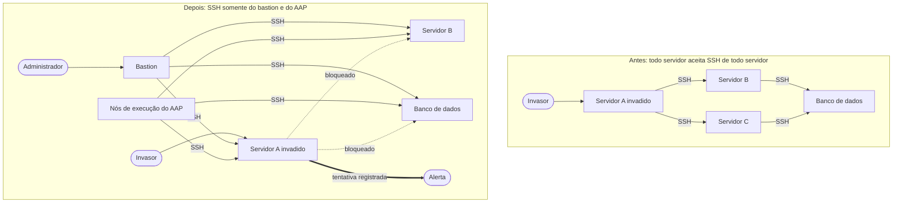

# LS-RHEL-001 — Aceitar SSH somente de origens administrativas

## Problema

Em muitas redes, todo servidor aceita SSH de todo outro servidor. Somado a chaves privadas esquecidas, encaminhamento de agente e senhas reutilizadas, isso torna o SSH o principal meio de movimentação lateral em ambientes Linux: quem invade um servidor salta para os demais com as credenciais que encontrar.

Servidores não precisam abrir SSH uns para os outros. A administração vem de poucos pontos: o bastion e os nós de execução do Ansible Automation Platform.

## Benefício

Um servidor invadido deixa de conseguir abrir SSH para os demais. Chaves privadas esquecidas, senhas reutilizadas e agentes encaminhados perdem o valor para o invasor, porque a porta simplesmente não responde a partir de outro servidor. O principal meio de movimentação lateral em ambientes Linux é fechado com uma regra de firewall por host.

O acesso administrativo passa a ter um único caminho — o bastion e o Ansible Automation Platform — que é onde se concentram autenticação forte, registro de sessão e monitoramento. E qualquer tentativa de SSH entre servidores vira, por definição, um alerta.



## Pré-requisitos

- Lista dos IPs de origem administrativa (bastion, nós de execução do AAP).
- Acesso de console fora de banda (console da VM, iLO/iDRAC) para o caso de bloqueio acidental.
- firewalld ativo.

## Avaliação

```bash
firewall-cmd --list-all-zones | grep -B8 -E 'services:.*\bssh\b' | grep -E '^\S|sources:|services:'
sshd -T | grep -E '^(passwordauthentication|permitrootlogin|allowagentforwarding|allowtcpforwarding) '
find /root /home -maxdepth 3 -path '*/.ssh/*' -type f ! -name '*.pub' ! -name 'authorized_keys' ! -name 'known_hosts*' ! -name 'config' 2>/dev/null
```

Indicadores de exposição:

- `ssh` liberado em uma zona sem `sources` definidos (aceita de qualquer origem).
- `passwordauthentication yes`, `permitrootlogin yes`, `allowagentforwarding yes`.
- Chaves privadas no servidor (terceiro comando): cada uma é uma credencial para outro sistema.

## Implementação

**1. Restringir a origem no firewalld.** Aplique primeiro só em tempo de execução, sem `--permanent`. Se algo der errado, `firewall-cmd --reload` ou uma reinicialização desfazem.

```bash
firewall-cmd --permanent --new-zone=ls-admin && firewall-cmd --reload   # criar zona exige --permanent

firewall-cmd --zone=ls-admin --add-source=192.0.2.10/32     # bastion
firewall-cmd --zone=ls-admin --add-source=192.0.2.20/32     # nó de execução do AAP
firewall-cmd --zone=ls-admin --add-service=ssh
firewall-cmd --zone=public --remove-service=ssh             # ajuste para a zona padrão em uso
```

Abra uma **nova** sessão SSH a partir do bastion, mantendo a atual aberta. Funcionando, torne permanente:

```bash
firewall-cmd --runtime-to-permanent
```

A zona de origem passa a valer para todo o tráfego desses IPs. Se o bastion também acessa outras portas do servidor, adicione-as à zona `ls-admin`.

**2. Endurecer o sshd.** No RHEL 9, crie `/etc/ssh/sshd_config.d/10-lateralshield.conf` (o prefixo baixo garante precedência); no RHEL 7 e 8, ajuste as mesmas diretivas em `/etc/ssh/sshd_config`:

```
PermitRootLogin no
PasswordAuthentication no
AllowAgentForwarding no
AllowTcpForwarding no
```

```bash
sshd -t && systemctl reload sshd
```

Antes de desativar senhas, confirme que os administradores e a automação já entram por chave.

**3. Remover chaves privadas dos servidores.** Chaves encontradas na avaliação devem ser removidas ou, se sustentam alguma integração, substituídas por uma chave dedicada, restrita no destino com `from=` e `command=` em `authorized_keys`.

## Validação

- Do bastion: `ssh <servidor>` funciona.
- De outro servidor qualquer: `ssh -o ConnectTimeout=5 <servidor>` esgota o tempo.
- `sshd -T` mostra as diretivas aplicadas.

## Reversão

```bash
firewall-cmd --permanent --zone=public --add-service=ssh
firewall-cmd --permanent --delete-zone=ls-admin
firewall-cmd --reload
```

Para o sshd, remova o arquivo `10-lateralshield.conf` (ou restaure as diretivas) e execute `systemctl reload sshd`.

## Impacto operacional

- Rotinas que copiam arquivos entre servidores por `scp`/`rsync` sobre SSH param. Identifique-as antes (`journalctl -u sshd | grep Accepted` mostra as origens em uso) e trate como exceção explícita, com chave dedicada e restrita.
- `AllowTcpForwarding no` impede túneis SSH. Se o túnel para o console do JBoss ([LS-JBOSS-001](../jboss-eap/LS-JBOSS-001-interfaces-de-gerenciamento.md)) for usado, libere o encaminhamento apenas para o grupo de administradores com um bloco `Match Group`.
- O bastion passa a ser ponto crítico: precisa de alta disponibilidade ou de um segundo bastion cadastrado.

## Detecção

Registre as tentativas de SSH vindas de origens não administrativas:

```bash
firewall-cmd --permanent --zone=public \
  --add-rich-rule='rule service name="ssh" log prefix="LS-RHEL-SSH: " level="warning" limit value="10/m" drop'
firewall-cmd --reload
```

Depois da restrição, um servidor tentando SSH em outro servidor é comportamento anômalo por definição. Encaminhe as mensagens `LS-RHEL-SSH` ao agregador de logs e alerte.

## Referências

- Documentação do RHEL: *Configuring firewalls and packet filters* (Using and configuring firewalld; Working with firewalld zones).
- Documentação do RHEL: *Securing networks* (Using secure communications between two systems with OpenSSH).
- `sshd_config(5)`.
