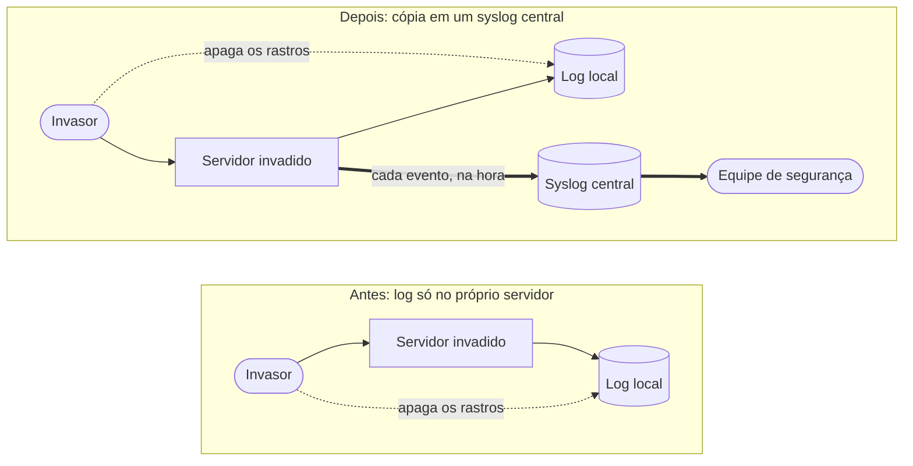

# LS-RHEL-002 — Encaminhar os logs do sistema para um syslog central

## Problema

Log que fica apenas no servidor só serve enquanto o servidor é confiável. Quem invade um host e obtém privilégio apaga ou altera os registros locais, e a equipe fica sem saber por onde o invasor entrou, o que executou e para onde foi.

Há um segundo problema: os controles de contenção e detecção deste catálogo geram sinais nos logs do sistema (`LS-JBOSS-EGRESS`, `LS-RHEL-SSH`, eventos do `auditd`). Sem encaminhamento, esses sinais ficam espalhados em cada servidor e ninguém os vê a tempo.

Por isso, **verificar se os logs saem do servidor é a primeira coisa a fazer em qualquer ambiente**.

## Benefício

Os registros passam a existir fora do alcance do invasor: mesmo que ele limpe o servidor, a cópia central permanece. A investigação de um incidente deixa de depender do host comprometido, e é possível reconstruir o caminho percorrido entre servidores a partir de um único lugar.

Os alertas dos demais controles do LateralShield ganham um destino: uma tentativa de SSH bloqueada ou um comando suspeito no JBoss chega à equipe em segundos, e não fica esquecida em um arquivo local.



## Pré-requisitos

- Um destino central de logs alcançável pelos servidores: servidor rsyslog, SIEM ou agregador com entrada syslog. Sem ele, o primeiro passo é criá-lo — um RHEL com rsyslog recebendo em TCP já resolve.
- Endereço, porta e protocolo do destino (os exemplos usam TCP 514).
- Liberação de rede dos servidores para o destino.
- `rsyslog` ativo (padrão no RHEL).

## Avaliação

```bash
systemctl is-active rsyslog
grep -rEsh '^[^#]*(@@?[A-Za-z0-9\[(]|omfwd)' /etc/rsyslog.conf /etc/rsyslog.d/ || echo "sem encaminhamento configurado"
```

- Nenhuma linha de encaminhamento: os logs existem apenas no servidor. **Sem detecção central.**
- Havendo encaminhamento, confirme que ele funciona de fato: gere uma mensagem (`logger -t lateralshield teste`) e procure-a no destino. Configuração apontando para um servidor desativado é um achado comum.

## Implementação

Crie `/etc/rsyslog.d/90-lateralshield-encaminhar.conf`:

```
action(type="omfwd"
       target="192.0.2.50" port="514" protocol="tcp"
       action.resumeRetryCount="-1"
       queue.type="linkedList"
       queue.filename="ls_encaminhar"
       queue.saveOnShutdown="on"
       queue.maxDiskSpace="1g")
```

A fila em disco guarda as mensagens enquanto o destino estiver indisponível e as envia quando ele voltar, sem travar o registro local.

```bash
rsyslogd -N1            # verifica a sintaxe
systemctl restart rsyslog
```

Em escala, a role `logging` das RHEL System Roles (`rhel-system-roles`) aplica a mesma configuração com Ansible.

Para que os eventos do `auditd` também sigam para o destino, ative o plugin de syslog do audit: `active = yes` em `/etc/audit/plugins.d/syslog.conf` (RHEL 8 e 9) ou `/etc/audisp/plugins.d/syslog.conf` (RHEL 7), e reinicie com `service auditd restart`.

Quando a rede entre os servidores e o destino não for confiável, use TLS (porta 6514, driver `gtls` do rsyslog).

## Validação

```bash
logger -t lateralshield "teste de encaminhamento $(hostname)"
```

A mensagem deve aparecer no destino central em poucos segundos, identificada com o nome do servidor de origem. Pare o destino por um minuto, gere outra mensagem e confirme que ela chega depois que o destino volta.

## Reversão

```bash
rm /etc/rsyslog.d/90-lateralshield-encaminhar.conf
systemctl restart rsyslog
```

## Impacto operacional

- Nenhum impacto nas aplicações. O registro local continua igual.
- O destino central precisa de espaço em disco, retenção definida e monitoramento próprio: se ele parar, a detecção para junto.
- Com SELinux em `enforcing`, portas de destino fora do padrão podem exigir ajuste (`semanage port -a -t syslogd_port_t -p tcp <porta>`). Verifique negações com `ausearch -m avc -ts recent`.
- O volume de rede é baixo em servidores comuns; servidores com log de depuração ligado podem gerar mais tráfego.

## Detecção

Este controle é a base dos demais. Dois sinais próprios merecem alerta no destino central:

- **Servidor que parou de enviar logs.** Silêncio inesperado de um host pode ser falha, mas também é o que acontece quando alguém desliga o encaminhamento.
- **Reinício do rsyslog ou do auditd fora de janela de mudança.**

## Referências

- Documentação do RHEL: *Configuring basic system settings* / *Security hardening* (Configuring a remote logging solution).
- Documentação do RHEL: *Automating system administration by using RHEL System Roles* (role `logging`).
- `rsyslog.conf(5)` e documentação do módulo `omfwd`.
