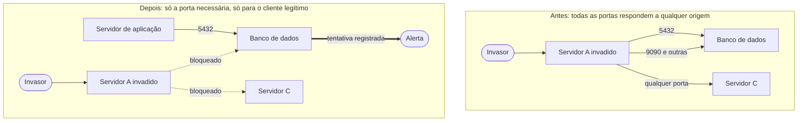

# LS-RHEL-008 — Liberar no firewalld somente os serviços e portas necessários

## Problema

Em redes internas, o firewall do host costuma estar desligado ou aberto demais: "já existe firewall no perímetro". O resultado é que todo serviço que escuta em um servidor — banco de dados, console de administração, agente de monitoramento, porta de depuração esquecida — fica acessível a qualquer outro servidor do mesmo segmento.

Quem invade um servidor começa varrendo os vizinhos. Cada porta que responde é um caminho possível: um serviço sem autenticação, uma versão vulnerável, uma interface de administração com senha padrão. Regras antigas pioram o quadro: a porta liberada para uma aplicação desativada continua aberta, à espera do próximo processo que a ocupe.

## Benefício

Um servidor invadido passa a enxergar, em cada vizinho, apenas as portas que aquele vizinho realmente oferece a ele. Serviços internos, como banco de dados e consoles, deixam de responder a quem não é cliente legítimo, mesmo estando no mesmo segmento de rede.

A varredura que antes devolvia dezenas de portas passa a devolver quase nada — e as tentativas ficam registradas. Para a operação, as regras do firewall viram a documentação de quem fala com quem.



## Pré-requisitos

- Para cada servidor, a lista do que ele oferece e para quem: porta, protocolo e origens legítimas.
- Acesso de console fora de banda.
- firewalld instalado. Se o servidor usa regras `nftables` ou `iptables` próprias, o princípio é o mesmo, mas os comandos deste controle não se aplicam.

## Avaliação

```bash
systemctl is-active firewalld
firewall-cmd --get-default-zone
firewall-cmd --get-active-zones
firewall-cmd --list-all-zones | grep -A14 '(active)'
ss -tulnp
```

Indicadores de exposição:

- firewalld inativo, sem outro filtro no host: **sem contenção**.
- Interface na zona `trusted`, ou zona com `target: ACCEPT`: tudo é aceito.
- Serviços ou portas liberados sem `sources`, para algo que só alguns clientes usam.
- Porta liberada no firewall sem nenhum processo escutando nela (compare com `ss`): regra obsoleta.
- Serviços padrão que ninguém usa, como `cockpit` e `dhcpv6-client` na zona `public`.
- Processo escutando em todas as interfaces (`0.0.0.0` ou `[::]`) quando só atende conexões locais.

## Implementação

**1. Ligar o registro de pacotes negados, antes de qualquer outra mudança.** O comando recarrega o firewall e descarta alterações feitas só em tempo de execução, por isso vem primeiro:

```bash
firewall-cmd --set-log-denied=unicast
```

**2. Desligar o que não é usado.** A melhor regra de firewall é não ter o serviço escutando: `systemctl disable --now <servico>` para o que a avaliação mostrou sem uso.

**3. Restringir em tempo de execução**, sem `--permanent`. Se algo der errado, `firewall-cmd --reload` ou uma reinicialização desfazem.

```bash
# remover o que é aberto a todos e não precisa ser
firewall-cmd --zone=public --remove-service=cockpit
firewall-cmd --zone=public --remove-port=8080/tcp

# liberar um serviço interno somente para os clientes legítimos
firewall-cmd --zone=public --add-rich-rule='rule family="ipv4" source address="192.0.2.30/32" port port="5432" protocol="tcp" accept'
```

Não remova o `ssh` aqui sem antes aplicar o [LS-RHEL-001](LS-RHEL-001-ssh-somente-de-origens-administrativas.md), que trata esse caso.

**4. Observar.** Acompanhe o log do kernel por um ciclo completo da aplicação e procure negações de origens legítimas que ficaram de fora:

```bash
journalctl -k --since "1 hour ago" | grep -E '_(REJECT|DROP): '
```

O prefixo exato das mensagens varia com a versão do firewalld e com o backend; confirme o padrão no servidor antes de montar filtros e alertas.

**5. Tornar permanente.**

```bash
firewall-cmd --runtime-to-permanent
```

Em escala, a role `firewall` das RHEL System Roles aplica o mesmo resultado com Ansible.

## Validação

- `firewall-cmd --list-all` mostra apenas os serviços e as regras previstos.
- De um cliente legítimo, a aplicação funciona.
- De outro servidor do mesmo segmento, a conexão à porta restrita falha, e a tentativa aparece no log do kernel do destino.
- Depois de uma reinicialização em janela, as regras permanecem.

## Reversão

Antes de tornar permanente: `firewall-cmd --reload`.

Depois, recoloque o que foi removido e recarregue:

```bash
firewall-cmd --permanent --zone=public --add-port=8080/tcp
firewall-cmd --reload
```

Para desligar o registro de negações: `firewall-cmd --set-log-denied=off`.

## Impacto operacional

- Integrações que ninguém documentou param: monitoramento, backup, replicação, balanceadores verificando a saúde do serviço. A fase de observação existe para encontrá-las.
- Serviços com portas dinâmicas (NFS em configurações antigas, alguns agentes) exigem fixar as portas ou usar o serviço predefinido do firewalld.
- O registro de negações pode ser volumoso em redes com muito tráfego de descoberta. `unicast` já exclui broadcast e multicast.
- Hosts que executam contêineres, máquinas virtuais ou que são nós do OpenShift têm regras gerenciadas por outras ferramentas. Não aplique este controle neles sem entender essa interação.
- As listas de origem precisam acompanhar a troca de IPs dos clientes.

## Detecção

Com `LogDenied` ativo, cada pacote negado gera uma mensagem no log do kernel com interface, origem, destino e porta. Encaminhe ao destino central ([LS-RHEL-002](LS-RHEL-002-syslog-central.md)) e alerte para:

- uma mesma origem interna negada em várias portas, ou em vários servidores, em poucos minutos: varredura a partir de um host comprometido;
- servidor de aplicação tentando portas de administração (SSH, consoles, banco de dados de outra aplicação) em servidores com os quais nunca falou.

Recargas do firewalld e mudanças de regra fora de janela também merecem alerta: desligar o firewall é um dos primeiros passos de quem obteve privilégio.

## Referências

- Documentação do RHEL: *Configuring firewalls and packet filters* (Using and configuring firewalld; Working with firewalld zones; Log for denied packets).
- Documentação do RHEL: *Automating system administration by using RHEL System Roles* (role `firewall`).
- `firewall-cmd(1)`, `firewalld.richlanguage(5)`, `firewalld.conf(5)`.
