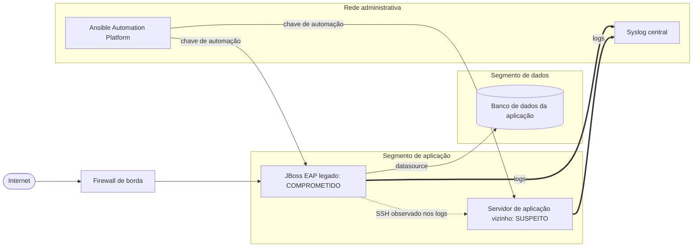

# Recomendações gerais para incidentes

O [catálogo](../catalogo/INDICE.md) reúne controles para aplicar **antes** de um incidente. Esta página reúne medidas de emergência para aplicar **durante** um incidente em andamento: ações rápidas, em geral temporárias, que reduzem a exposição enquanto a equipe investiga.

Para saber o que conferir e em que ordem durante a crise, use o [guia de crise](guia-de-crise.md): um checklist da sala de crise que cita estas recomendações nos pontos em que cada uma se aplica.

Três diferenças em relação ao catálogo:

- **Não são controles.** Não têm identificador, status nem passam pelo validador. São recomendações, e cada ambiente decide se e como aplicá-las.
- **Nem todas são específicas de tecnologias Red Hat.** Várias acontecem no perímetro de rede ou no processo da equipe. Estão aqui porque protegem ambientes Red Hat durante a crise; quando existe um controle do catálogo relacionado, ele é citado.
- **São genéricas de propósito.** Os comandos dependem do equipamento de borda, do provedor de nuvem e da topologia de cada ambiente. A página diz o que fazer e o que pode dar errado, não a sintaxe de cada fabricante.

## Regras para qualquer medida de emergência

1. **Dono e prazo.** Toda medida é registrada com quem aplicou, quando, por quê e até quando vale. Medida de emergência sem prazo vira configuração permanente que ninguém sabe explicar.
2. **Reversão conhecida antes de aplicar.** Se não se sabe desfazer, não é medida de emergência, é mudança de risco.
3. **Registrar o que foi bloqueado.** Um bloqueio que não gera log tira da equipe a informação de que ela mais precisa.
4. **Conter antes de limpar.** Remover o invasor de um servidor enquanto ele ainda alcança os outros só o avisa de que foi percebido.
5. **Não confundir redução de ruído com contenção.** Algumas medidas abaixo apenas diminuem o volume de ataque; a tabela indica quais.

## Resumo

| Recomendação | Efeito | Reduz ruído ou contém? |
|---|---|---|
| [Aceitar entrada apenas do Brasil](#aceitar-entrada-apenas-do-brasil-no-perímetro) | Menos origens conseguem alcançar os serviços publicados | Reduz ruído |
| [Fechar interfaces administrativas expostas](#fechar-interfaces-administrativas-expostas-à-internet) | Administração só por VPN ou rede administrativa | Contém |
| [Restringir a saída para a internet](#restringir-a-saída-dos-servidores-para-a-internet) | Dificulta comando remoto e saída de dados | Contém |
| [Isolar sem desligar](#isolar-o-componente-suspeito-sem-desligá-lo) | O componente suspeito para de alcançar os vizinhos e a evidência é mantida | Contém |
| [Preservar evidências](#preservar-evidências-antes-de-limpar) | A investigação continua possível depois da limpeza | — |
| [Trocar credenciais na ordem certa](#trocar-credenciais-na-ordem-certa) | Credenciais expostas deixam de valer | Contém |
| [Desenhar a topologia dos ativos envolvidos](#desenhar-a-topologia-dos-ativos-envolvidos) | Todos enxergam o mesmo mapa: o que foi atingido, o que está ao alcance e onde bloquear | — |
| [Organizar a resposta](#organizar-a-resposta) | Decisões registradas e comunicação fora do ambiente afetado | — |
| [Encerrar o incidente](#encerrar-o-incidente) | Medidas temporárias viram controle permanente ou são removidas | — |

## Perímetro de rede

### Aceitar entrada apenas do Brasil no perímetro

**Quando usar.** O serviço atende essencialmente usuários no Brasil e o incidente envolve grande volume de origens no exterior: varredura, tentativa de senha em massa, exploração automatizada de uma falha recém-divulgada.

**O que fazer.** No firewall de borda, WAF ou CDN, permitir a entrada nos serviços publicados apenas de endereços alocados ao Brasil e registrar o que for descartado. Aplicar no ponto mais externo que enxerga o endereço real do cliente: se há CDN ou proxy na frente, a regra precisa estar nele, porque o firewall atrás só vê os endereços do próprio CDN. Quando a borda é um host RHEL, o `firewalld` aceita conjuntos de endereços (`ipset`) como origem de uma zona.

**Cuidados.**

- **Não é contenção.** Um invasor determinado usa uma origem no Brasil (VPN, hospedagem local, máquina comprometida). A medida reduz volume e ganha tempo; não substitui corrigir a falha explorada.
- **Não remove quem já entrou.** Atua só na entrada. Um invasor que já tem acesso interno, ou que usa conexões iniciadas de dentro para fora, não é afetado; para isso, veja [restringir a saída](#restringir-a-saída-dos-servidores-para-a-internet).
- **Quebra integrações legítimas.** Antes de aplicar, liste o que chega de fora do país: gateways de pagamento, webhooks, monitoramento externo, provedores de e-mail, parceiros, usuários em viagem e equipes no exterior. Crie exceções explícitas para esses endereços.
- **Geolocalização de IP é aproximada.** As bases erram, especialmente com operadoras móveis e provedores de nuvem. Espere alguns bloqueios indevidos e tenha um canal para o usuário reclamar.
- **Não esquecer do IPv6.** Uma regra só para IPv4 deixa a outra metade aberta.
- **A lista envelhece.** As alocações mudam; se a medida durar mais que alguns dias, a lista precisa de atualização automática.

**Como desfazer.** Remover a regra de bloqueio por país e manter as exceções documentadas. Definir a data de revisão no momento da aplicação.

### Fechar interfaces administrativas expostas à internet

**Quando usar.** Sempre que o incidente revelar SSH, consoles de gerenciamento, API ou console do OpenShift ou a interface do Ansible Automation Platform acessíveis diretamente da internet.

**O que fazer.** Restringir essas portas no perímetro à VPN ou à rede administrativa. É a versão de emergência, feita na borda, do que os controles [LS-RHEL-001](../catalogo/rhel/LS-RHEL-001-ssh-somente-de-origens-administrativas.md) e [LS-JBOSS-001](../catalogo/jboss-eap/LS-JBOSS-001-interfaces-de-gerenciamento.md) fazem no próprio host.

**Cuidados.** Confirmar antes que a equipe de resposta consegue entrar pelo caminho que vai sobrar. Pipelines e automações externas que usam a API do cluster param de funcionar.

**Como desfazer.** Reabrir a regra anterior. Na prática, esta medida deveria se tornar permanente.

### Restringir a saída dos servidores para a internet

**Quando usar.** Há suspeita de que um servidor comprometido está recebendo comandos de fora ou enviando dados para fora.

**O que fazer.** No perímetro, negar a saída direta dos segmentos de servidores para a internet, permitindo apenas os destinos necessários (proxy corporativo, repositórios de pacotes, serviços de parceiros) e registrando o restante. As tentativas registradas mostram quais outros servidores apresentam o mesmo comportamento.

**Cuidados.** Atualizações de pacotes, consultas a serviços externos, envio de e-mail e validação de certificados podem parar. Aplicar primeiro em modo de registro, se o tempo permitir, para conhecer o tráfego legítimo.

**Como desfazer.** Remover a regra de negação. Para tornar o controle permanente e mais fino, por processo, veja [LS-JBOSS-002](../catalogo/jboss-eap/LS-JBOSS-002-egress-por-usuario.md).

## Contenção e evidências

### Isolar o componente suspeito sem desligá-lo

**Quando usar.** Um servidor, pod ou nó está sob suspeita e ainda não foi investigado.

**O que fazer.** Cortar a comunicação do componente com o restante do ambiente e mantê-lo ligado. Desligar ou reinstalar apaga o conteúdo da memória e os processos em execução, que costumam ser a melhor evidência.

- **Servidor RHEL ou JBoss EAP:** mover para uma rede de quarentena ou negar o tráfego no firewall ou no grupo de segurança, mantendo apenas o acesso da equipe de resposta.
- **OpenShift:** isolar o namespace com uma `NetworkPolicy` de negação (ver [LS-OCP-002](../catalogo/openshift/LS-OCP-002-networkpolicy-negacao-padrao.md)) e impedir novos agendamentos no nó suspeito (`oc adm cordon`). Apagar o pod destrói a evidência; prefira retirá-lo do tráfego e preservá-lo para análise.

**Cuidados.** O isolamento derruba o serviço que o componente presta. A decisão entre disponibilidade e contenção é do negócio e precisa de um responsável definido.

**Como desfazer.** Devolver o componente à rede original somente depois da análise e, de preferência, depois de reconstruí-lo a partir de fonte confiável.

### Preservar evidências antes de limpar

**Quando usar.** Antes de qualquer reinício, reinstalação, restauração de backup ou remoção de arquivos suspeitos.

**O que fazer.**

- Confirmar que os logs do componente já estão no destino central; se não estiverem, copiá-los para fora do host. Ver [LS-RHEL-002](../catalogo/rhel/LS-RHEL-002-syslog-central.md), [LS-OCP-003](../catalogo/openshift/LS-OCP-003-log-de-acesso-do-ingress-em-syslog.md) e [LS-JBOSS-004](../catalogo/jboss-eap/LS-JBOSS-004-logs-do-jboss-em-syslog.md).
- Tirar um snapshot da máquina virtual ou do disco.
- Aumentar a retenção dos logs no destino central enquanto durar a investigação, para que a rotação normal não apague o período de interesse.
- Anotar horários no mesmo fuso em todos os registros.

**Cuidados.** Snapshots e cópias de log contêm dados sensíveis e credenciais: guardar com acesso restrito e prazo de descarte.

**Como desfazer.** Descartar as cópias ao final do prazo de retenção definido para o incidente.

## Identidades e credenciais

### Trocar credenciais na ordem certa

**Quando usar.** Um componente comprometido tinha acesso a credenciais: senhas de datasource, chaves SSH, tokens de service account, credenciais guardadas no Ansible Automation Platform.

**O que fazer.**

1. **Conter primeiro.** Trocar a senha enquanto o invasor ainda lê o arquivo de configuração só entrega a senha nova.
2. **Listar o que o componente alcançava.** Tudo o que estava legível para o processo ou usuário comprometido deve ser tratado como exposto, mesmo sem prova de uso.
3. **Começar pelas credenciais de maior alcance:** contas administrativas, chaves de automação que entram em muitos servidores (ver [LS-AAP-001](../catalogo/aap/LS-AAP-001-chave-de-automacao-restrita.md)), contas de serviço compartilhadas.
4. **Encerrar sessões e tokens ativos**, não apenas trocar a senha: uma sessão aberta continua valendo depois da troca.

**Cuidados.** Troca de credencial compartilhada derruba todos os sistemas que a usam. Mapear os consumidores antes e trocar de forma coordenada.

**Como desfazer.** Não se desfaz: uma credencial exposta não volta a ser confiável.

## Organização da resposta

### Desenhar a topologia dos ativos envolvidos

**Quando usar.** Logo no início, assim que houver um primeiro ativo confirmado ou suspeito. Sem um desenho, cada pessoa da equipe trabalha com um mapa diferente na cabeça, e as medidas de contenção são aplicadas no lugar errado ou deixam um caminho aberto.

**O que fazer.** Desenhar apenas o que interessa ao incidente, não a rede inteira:

- **os ativos confirmados e os suspeitos**, com marcação diferente para cada situação;
- **o que cada um alcança**: bancos de dados, outros servidores, plano de controle do cluster, interfaces de gerenciamento, internet;
- **o que alcança cada um**: por onde o invasor pode ter entrado e por onde a administração e a automação chegam;
- **os pontos de bloqueio disponíveis** em cada caminho: firewall de borda, firewall entre segmentos, firewall do host, `NetworkPolicy`;
- **as credenciais que atravessam o desenho**: chaves de automação, contas de serviço e senhas de datasource ligam ativos que a rede não liga;
- **para onde vão os logs** de cada ativo.

O desenho não precisa ser bonito: quadro branco fotografado ou um diagrama Mermaid como o do exemplo servem. Precisa ter data e hora e ser atualizado a cada descoberta, guardando as versões anteriores junto da linha do tempo.

Linhas contínuas são caminhos legítimos, tracejadas são movimentações observadas ou suspeitas e grossas são o envio de logs.

**Cuidados.**

- **O desenho é informação sensível.** Mostra exatamente o que está exposto: guardar fora do ambiente afetado e com acesso restrito à equipe de resposta.
- **Desenhar o que se observa, não o que a documentação diz.** Diagramas de arquitetura antigos costumam estar desatualizados; conferir os caminhos com as regras de firewall e os logs reais.
- **Separar fato de hipótese.** Um ativo marcado como comprometido sem evidência desvia a investigação; um marcado como limpo sem verificação é pior.
- **Não publicar com dados reais.** Em relatos e contribuições para este projeto, trocar endereços e nomes por valores de exemplo.

**Como desfazer.** Não há o que desfazer. Ao encerrar o incidente, a versão final vai para o relatório e as cópias de trabalho são descartadas. Os caminhos que apareceram no desenho e não deveriam existir são os candidatos a controle do [catálogo](../catalogo/INDICE.md).

### Organizar a resposta

- **Um responsável pelo incidente**, com autoridade para decidir entre manter o serviço no ar e conter.
- **Linha do tempo única**, com cada ação tomada, por quem e a que horas. É o que permite desfazer as medidas de emergência depois.
- **Canal de comunicação fora do ambiente afetado.** Se o e-mail ou o chat corporativo podem estar comprometidos, a coordenação precisa de outro meio.
- **Congelar mudanças não relacionadas.** Implantações e manutenções durante o incidente confundem a investigação e escondem o que o invasor fez.
- **Obrigações de comunicação.** Envolver cedo as áreas jurídica e de privacidade: incidentes com dados pessoais podem exigir comunicação a autoridades e titulares em prazo definido.

### Encerrar o incidente

Para cada medida de emergência registrada na linha do tempo, decidir explicitamente:

- **vira permanente**, e então passa a ser tratada como controle, com avaliação, validação e reversão (procure o equivalente no [catálogo](../catalogo/INDICE.md) ou proponha um novo controle); ou
- **é removida**, com data e responsável.

Depois, rodar as avaliações do catálogo nos componentes envolvidos: o caminho que o invasor percorreu indica quais controles de contenção faltavam.

## Referências

- [NIST SP 800-61 Rev. 3 — Incident Response Recommendations and Considerations for Cybersecurity Risk Management](https://csrc.nist.gov/pubs/sp/800/61/r3/final)
- [CERT.br — Centro de Estudos, Resposta e Tratamento de Incidentes de Segurança no Brasil](https://www.cert.br/)
- [LACNIC — estatísticas de alocação de endereços por país](https://ftp.lacnic.net/pub/stats/lacnic/)
- [Metodologia do LateralShield](metodologia.md) e [modelo de ameaça](modelo-de-ameaca.md)
